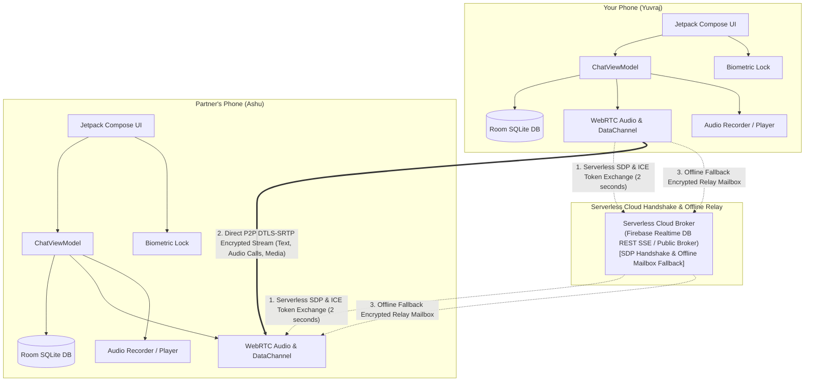

# AshuChat ❤️ (100% Serverless P2P)

[](https://developer.android.com)
[](https://kotlinlang.org)
[](https://developer.android.com/jetpack/compose)
[](https://webrtc.org)
[](#)

A private, modern, **serverless peer-to-peer (P2P)** messaging, encrypted voice calling, and media sharing app for Android built with **Kotlin**, **Jetpack Compose**, and **WebRTC DataChannels**.

Designed with love for couples to chat, make encrypted crystal-clear voice calls, exchange high-res photos, record push-to-talk voice notes, and send heartbeat "Love Pings" directly phone-to-phone with **zero servers to host or manage** and **end-to-end encryption**.

---

## ⚡ What Makes It 100% Serverless?

- **No Backend to Host or Run**: You do **NOT** need a VPS, Docker container, Node.js server, or local Python script.
- **Serverless Cloud Handshake**: Initial peer discovery uses serverless cloud channels (Google Firebase Realtime Database REST SSE / Public cloud broker) solely to exchange the 2-second WebRTC handshake.
- **Direct Phone-to-Phone**: Once the handshake completes, all text messages, voice calls, voice notes, attachments, and Love Pings stream directly between devices over **WebRTC (DTLS-SRTP 256-bit encryption)**.
- **Offline Mailbox Fallback**: If your partner is offline or backgrounded, messages and voice notes automatically queue in a serverless encrypted cloud mailbox and deliver immediately once they open the app.
- **Zero Cloud Storage of Chats**: No server ever touches, reads, or permanently stores your messages or pictures.

---

## ✨ Features

### 🔒 Biometric App Lock & Privacy Suite
- **Biometric Authentication (`BiometricPrompt`)**: Secure the app with Fingerprint or Face Unlock upon startup and when resuming from the background.
- **Anti-Screenshot & Screen Guard (`FLAG_SECURE`)**: Prevent screenshots and screen recording, and obscure chat previews in Android's recent apps switcher.
- **Disappearing Messages**: Set self-destruct timers (**Off**, **30s**, **5m**, **1h**, **24h**) with automated background deletion of messages and cached attachment files.

### 📞 Direct P2P Encrypted Voice Calls
- **Crystal-Clear Audio**: Hardware-accelerated WebRTC audio pipeline with acoustic echo cancellation (`googEchoCancellation`), noise suppression (`googNoiseSuppression`), and automatic gain control (`googAutoGainControl`).
- **In-App Call Overlay**: Full-screen calling screen with partner avatar, live call timer, one-tap Mute (`Mic` / `MicOff`), and Speakerphone (`VolumeUp` / `VolumeOff`) toggles.

### 🔔 24/7 Background Operation & Call Ringing
- **Always-On Background Listener**: Runs a persistent low-power foreground synchronization service (`ChatSyncService`) and global connection manager (`ChatConnectionManager`) that survives app exit and Android Doze mode.
- **Rings While App Is Closed**: Incoming calls trigger high-priority lockscreen wake-ups (`USE_FULL_SCREEN_INTENT`), looping device ringtones, vibration patterns, and notification action buttons (**Answer** / **Decline**) directly from the lock screen.
- **Boot Auto-Start**: Automatically boots connection listeners when your phone restarts (`RECEIVE_BOOT_COMPLETED`).
- **Battery Optimization Exemption Helper**: One-tap toggle inside Chat Settings to prevent OEM battery-savers (MIUI, OneUI, ColorOS) from killing background signaling.

### 🎙️ Push-to-Talk Voice Notes
- **High-Fidelity Audio Recording**: AAC encoding in MPEG-4 (`.m4a`) at 44.1kHz / 96kbps with real-time waveform amplitude bars and duration counter.
- **Inline Audio Player**: Play/pause toggle, scrubbable progress indicator, elapsed/total duration, and variable playback speed selector (`1.0x`, `1.5x`, `2.0x`).

### ❤️ Message Reactions & Quote Reply
- **Emoji Reactions**: Long-press any message bubble to open the reaction picker (❤️, 😂, 😮, 😢, 👍, ⚡) with pinned reaction badges on bubbles.
- **Quote-to-Reply**: Reply to specific messages with a quote banner above the input field and styled quotation blocks inside chat bubbles.

### 📸 High-Speed Attachment & Media Sharing
- **Full-Resolution Photos & Files**: Share camera captures, gallery photos, videos, and documents without compression degradation.
- **Full-Screen Media Viewer**: Zoomable image viewer with pinch-to-zoom and save actions.
- **Chunked Transfer**: WebRTC binary streaming with real-time transfer progress bars.

### 💖 Romantic Couples Touch
- **Love Ping ⚡**: Send an instant heartbeat pulse. Triggers a rhythmic vibration and an animated glowing banner on the receiver's phone.
- **Real-Time Indicators**: Live "typing..." indicator and delivery receipts (*Sending* 🕒, *Sent* ✓, *Delivered* ✓✓).

### 📱 Instant Pairing & Rooms
- **QR Code Handshake**: Show a pairing QR code or scan with CameraX + ML Kit barcode reader.
- **Room Code**: Enter matching room codes (e.g., `ASHU-882`).
- **Multi-Room Chat**: Manage multiple chat rooms with persistent histories and custom nicknames.

### 🔄 In-App Auto-Updates
- Built-in GitHub Releases update checker with direct background download and installation prompts without needing Google Play Store.

---

## 🏗️ Serverless Architecture



---

## 📂 Project Structure

```
AshuChat/
├── app/
│   ├── build.gradle.kts                   # Dependencies & plugins
│   ├── proguard-rules.pro                 # R8 / ProGuard rules for WebRTC & Biometrics
│   └── src/main/
│       ├── AndroidManifest.xml            # Permissions, FileProvider & Activities
│       └── java/com/ashuchat/app/
│           ├── AshuChatApp.kt             # Application lifecycle
│           ├── MainActivity.kt            # FragmentActivity, Biometric & Navigation
│           ├── data/
│           │   ├── local/                 # Room DB, Entity & DAO
│           │   ├── model/                 # Message, Packets, CallState
│           │   └── repository/            # Chat & Preferences Repositories
│           ├── webrtc/
│           │   ├── WebRtcManager.kt       # WebRTC Audio Tracks, DataChannel & ICE
│           │   ├── SignalingClient.kt     # Serverless SSE & WebSocket client
│           │   └── FileTransferManager.kt # Chunking & stream backpressure
│           ├── ui/
│           │   ├── theme/                 # Dark midnight & rose color palette
│           │   ├── components/            # ChatBubble, Badges, BiometricLock, Overlays
│           │   ├── screens/               # ChatScreen, PairingScreen, SettingsScreen
│           │   └── viewmodel/             # ChatViewModel
│           └── utils/                     # AudioRecorder, AudioPlayer, Biometrics, Updates
├── build.gradle.kts
└── settings.gradle.kts
```

---

## 🚀 Getting Started

### Prerequisites
- Android Studio Hedgehog (2023.1.1) or newer
- JDK 17
- Android Device or Emulator running Android 8.0+ (API level 26+)

### Step 1: Open and Build
1. Open **Android Studio**.
2. Select **Open** and choose `/Users/yuvraj/Documents/Projects/AshuChat`.
3. Let Gradle sync dependencies.
4. Build the project:
   ```bash
   ./gradlew assembleDebug
   ```

### Step 2: Pairing Up
1. Install **AshuChat** on both Android devices.
2. Enter your nicknames.
3. **Pair Up**:
   - **Method A (QR Code)**: One phone displays the pairing QR code; the other phone taps **Scan QR Code**.
   - **Method B (Room Code)**: Enter the matching 6-character room code (e.g., `ASHU-882`) on both phones.
4. Tap **Connect & Open Chat**.
5. The badge will switch to 🟢 **Direct P2P Active**!

---

## 🔒 Security & Privacy Architecture

- **Transport Encryption**: WebRTC audio and DataChannels are encrypted end-to-end with DTLS-SRTP 256-bit encryption.
- **Zero Intermediary Storage**: No central server logs or stores your chats, calls, or media.
- **Biometric Hardware Isolation**: Leverages Android's `KeyStore` and `BiometricPrompt` framework with StrongBox / TEE support.
- **Screen Protection**: `FLAG_SECURE` blocks external recording, screen mirroring, and screenshots.
- **Ephemeral Cleanup**: Disappearing messages automatically purge local SQLite records and delete cached files from disk.

---

## 🛠️ Technology Stack

- **UI**: Jetpack Compose, Material 3, Accompanist
- **Language**: Kotlin, Coroutines, Flow
- **Real-Time P2P**: Google WebRTC (`stream-webrtc-android`), DTLS-SRTP
- **Database**: Android Jetpack Room (SQLite)
- **Audio**: Android `MediaRecorder` (AAC), `MediaPlayer` with playback pitch/speed control
- **Biometrics**: `androidx.biometric:biometric`
- **Networking**: OkHttp, Firebase Realtime Database REST SSE
- **Computer Vision**: CameraX, Google ML Kit Barcode Scanning, ZXing Core
