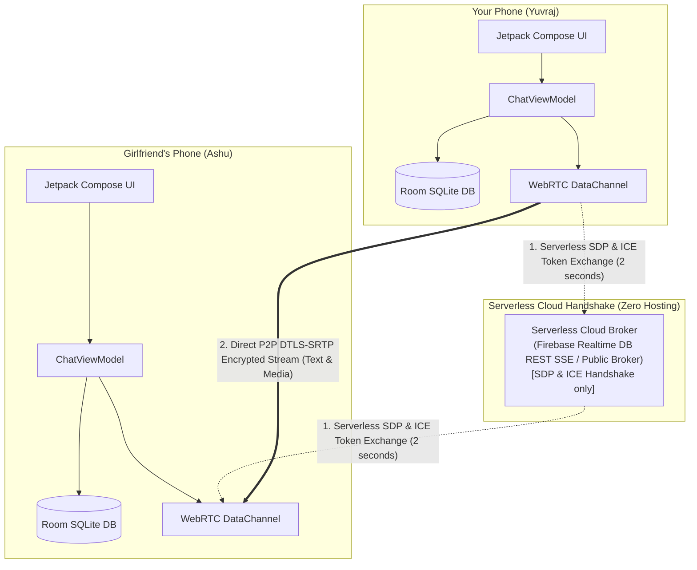

# AshuChat ❤️ (100% Serverless P2P)

A private, modern, **serverless peer-to-peer (P2P)** messaging and media sharing app for Android built with **Kotlin**, **Jetpack Compose**, and **WebRTC DataChannels**.

Designed with love for couples to chat, exchange high-res photos, share files, and send heartbeat "Love Pings" directly phone-to-phone with **zero servers to host or manage** and **end-to-end encryption**.

---

## ⚡ What Makes It 100% Serverless?

- **No Backend to Host or Run**: You do **NOT** need a VPS, Docker container, Node.js server, or local Python script.
- **Serverless Cloud Handshake**: Initial peer discovery uses serverless cloud channels (Google Firebase Realtime Database REST SSE / Public cloud broker) solely to exchange the 2-second WebRTC handshake.
- **Direct Phone-to-Phone**: Once the handshake completes, all text messages, attachments, photos, and Love Pings stream directly between your phone and your girlfriend's phone over **WebRTC DataChannels (DTLS-SRTP 256-bit encryption)**.
- **Zero Cloud Storage of Chats**: No server ever touches, reads, or stores your messages or pictures.

---

## ✨ Features

- 🔒 **Direct Peer-to-Peer Encryption**: DTLS-SRTP 256-bit encryption for all peer traffic.
- 📸 **High-Speed Attachment Sharing**:
  - Send camera photos, gallery pictures, videos, and documents of any format.
  - Chunked binary transmission over WebRTC with backpressure control.
  - Real-time transfer progress bars.
- 🔍 **Full-Screen Media Viewer**: Tap any photo in the conversation to open a high-res viewer with pinch-to-zoom and save options.
- 📱 **Instant Pairing**:
  - **QR Code Handshake**: Show your pairing QR code or scan your girlfriend's screen using CameraX + ML Kit.
  - **6-Digit Room Code**: Or enter the matching room code (e.g. `ASHU-882`).
- 💖 **Romantic Couples Touch**:
  - **Love Ping**: Send an instant heartbeat pulse. Vibrates the receiver's phone with a heartbeat rhythm and triggers a floating heart burst across the screen.
  - **Typing Indicator**: Real-time "typing..." notification.
  - **Delivery Receipts**: Message status ticks (*Sending* 🕒, *Sent* ✓, *Delivered* ✓✓).
- 💾 **Local Offline History**: Chat history is persisted safely on device storage using Android Room (SQLite). Old messages remain available even when offline.
- 🎨 **Modern Dark Aesthetic**: Intimate, romantic dark theme with rose gradients, frosted surfaces, and fluid micro-animations.

---

## 🏗️ Serverless Architecture



---

## 📂 Project Structure

```
AshuChat/
├── app/
│   ├── build.gradle.kts                   # Dependencies & plugins
│   └── src/main/
│       ├── AndroidManifest.xml            # Permissions & FileProvider
│       └── java/com/ashuchat/app/
│           ├── AshuChatApp.kt             # Application init
│           ├── MainActivity.kt            # Compose Navigation
│           ├── data/
│           │   ├── local/                 # Room DB, Entity & DAO
│           │   ├── model/                 # Message, Signaling, Packets
│           │   └── repository/            # Chat & Preferences Repositories
│           ├── webrtc/
│           │   ├── WebRtcManager.kt       # PeerConnection, STUN & DataChannel
│           │   ├── SignalingClient.kt     # Serverless & WebSocket Signaling client
│           │   └── FileTransferManager.kt # Binary chunking & stream backpressure
│           ├── ui/
│           │   ├── theme/                 # Romantic color palette & typography
│           │   ├── components/            # ChatBubble, Badges, QR Views
│           │   ├── screens/               # PairingScreen, ChatScreen, Settings
│           │   └── viewmodel/             # ChatViewModel
│           └── utils/                     # FileUtils, QrUtils, NotificationHelper
├── relay-server/                          # Optional self-hosted signaling server
│   ├── server.py                          # Zero-dependency Python relay (Local Wi-Fi)
│   ├── server.js                          # Node.js WebSocket broker (Render / Railway)
│   ├── package.json                       # npm start script
│   └── Dockerfile                         # Container deployment
├── build.gradle.kts
└── settings.gradle.kts
```

---

## 🚀 Getting Started (Zero Server Setup!)

### Step 1: Open in Android Studio
1. Open **Android Studio**.
2. Select **Open** and choose `/Users/yuvraj/Documents/Projects/AshuChat`.
3. Android Studio will automatically resolve Gradle dependencies.
4. Plug in your Android device (or launch an emulator) and click **Run (▶)**.

---

### Step 2: Pairing with Your Girlfriend

1. Install and launch **AshuChat** on both Android devices.
2. Enter your nicknames (*Yuvraj* on your phone, *Ashu* on her phone).
3. **Pair Up**:
   - **Method A (QR Code)**: One phone displays the pairing QR code; the other phone taps **"Scan Girlfriend's QR Code"** and points the camera.
   - **Method B (Room Code)**: Enter the matching 6-character room code (e.g. `ASHU-882`) on both phones.
4. Tap **Connect & Open Chat**.
5. The badge will switch to 🟢 **Direct P2P Active**!
6. You can now chat, share photos, exchange files, and send Love Pings with **zero server infrastructure**!

---

## 🔒 Security & Privacy

- **Transport Encryption**: WebRTC DataChannels are encrypted end-to-end via DTLS-SRTP 256-bit encryption.
- **Zero Intermediary Storage**: No cloud server receives or saves your chat messages or pictures.
- **Local SQLite Storage**: Your conversations are stored only on your local devices in an encrypted app-private sandbox.
